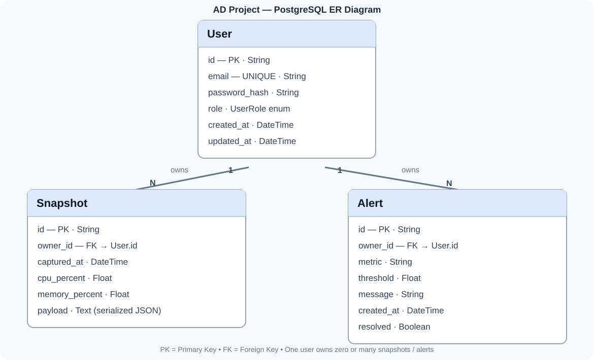
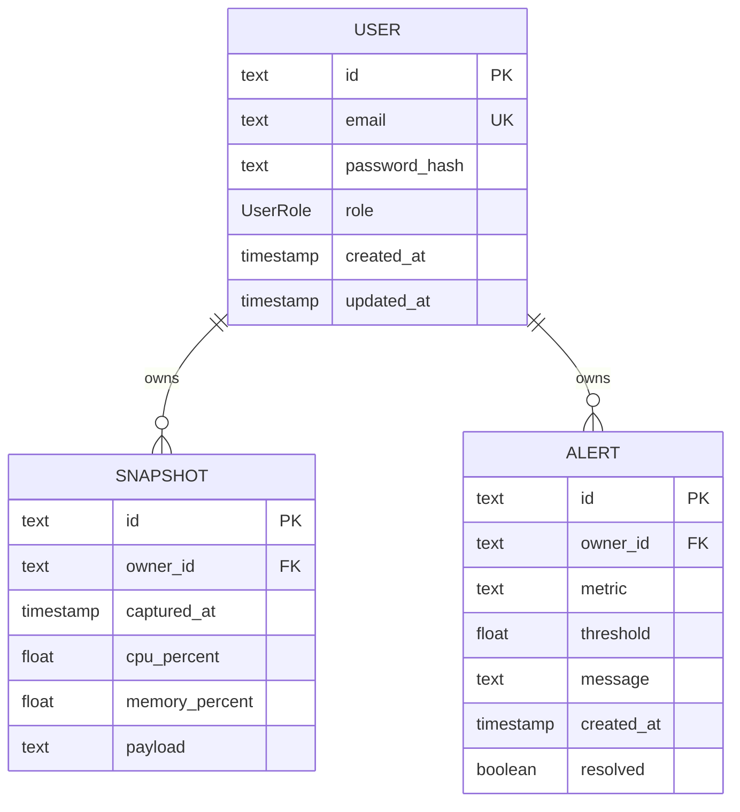

# 2. ER diagram

Cardinality:

- One `USER` owns zero or many `SNAPSHOT` rows.
- One `USER` owns zero or many `ALERT` rows.
- Every `SNAPSHOT.owner_id` references exactly one `USER`.
- Every `ALERT.owner_id` references exactly one `USER`.
